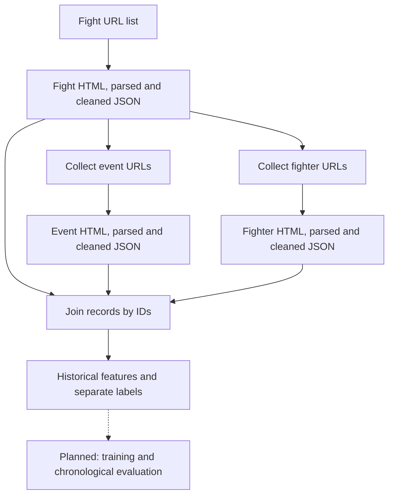
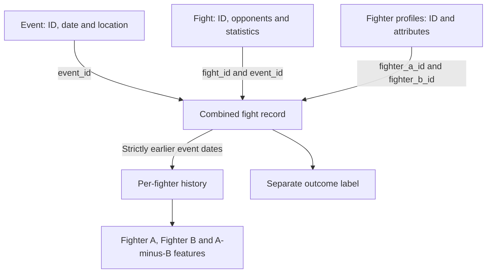

# UFC Fight Predictor

A Python data engineering project building the foundation for UFC fight-outcome prediction. It turns UFCStats fight, event and fighter pages into structured records, then constructs pre-fight features using only previously observed fights.

[Source code](https://github.com/Shepho01/ufc-fight-predictor)

**Current scope:** scraping, parsing, cleaning, record construction and historical feature engineering. This repository snapshot does not include model-training scripts, trained models or evaluation results.

## What the project demonstrates

- A staged pipeline that preserves raw HTML alongside parsed and cleaned JSON.
- Joining fight statistics, event dates and fighter profiles by stable IDs.
- Historical feature construction designed to prevent current-fight and future-fight leakage.
- Explicit treatment of missing values, draws and no contests.
- Automated tests for chronology, identity tracking and statistical aggregation.

## Technology

| Area | Tools |
| --- | --- |
| Language | Python; developed with Python 3.11 |
| Collection | Playwright |
| HTML parsing | Beautiful Soup |
| Data storage | HTML snapshots and JSON files |
| Processing | Python standard library |
| Tests | `unittest` |

The current storage layer is file-based; there is no SQL database in this snapshot.

## Data pipeline



The collectors extract event and fighter URLs from cleaned fight files. Downloading a fighter profile does **not** automatically collect every earlier fight in that fighter's career; those fight pages must also be added to the input collection.

## Data relationships



`build_fight_record.py` checks that the fight appears in its event and that both fighter profiles exist. It also calculates age at the event date. Profile height, weight, reach and stance remain snapshot attributes; they are not verified historical measurements and are not included by the historical-feature builder's allowlist.

## Historical features

For each fight, the builder emits features for each opponent and A-minus-B differences when both values are available.

| Group | Examples |
| --- | --- |
| Observed record | Prior fights, wins, losses, draws and no contests |
| Results and recency | Decisive win rate; days since the previous observed fight |
| Accuracy | Significant-strike and takedown accuracy |
| Defense | Significant-strike and takedown defense |
| Per-fight averages | Knockdowns, significant strikes landed/attempted, takedowns landed, submission attempts and control seconds |
| Coverage | Number of observations supporting each statistic |

### Preventing leakage

1. Records are sorted by event date and fight ID.
2. Features are emitted for all fights on a date **before** any results from that date update history.
3. A fighter's history follows their ID even when they switch between the A and B sides.
4. Features use an explicit allowlist; current-fight outcomes and profile career totals are excluded.
5. Labels are stored separately: `fighter_a_win` is `1` for a win, `0` for a loss and `null` for a draw or no contest.

For example, a prediction row dated 11 February 2023 can use collected fights before that date. It cannot use that fight's statistics or any later rematch.

Accuracy is calculated as total landed divided by total attempted over complete observations, rather than averaging per-fight percentages. Missing statistics remain `null`; they are not silently replaced with zero. A zero denominator also produces `null`.

## Dataset scope and limitations

The inspected snapshot contains **35 cleaned fights, 35 cleaned events, 32 cleaned fighter profiles and 35 combined fight records**. These counts describe the supplied data, not UFC-wide coverage.

- `prior_fights` means earlier fights present in this dataset, not a complete professional record.
- Missing earlier bouts can distort apparent experience, recency and averages.
- First observed fights have zero prior observations and unknown rate features.
- Averages are per observed fight, not per minute, so fight duration can affect comparisons.
- A small, selectively collected sample is not enough to claim reliable predictive accuracy.
- Training and evaluation are the next stage represented in this snapshot; no performance claims are made here.

## Run locally

Run commands from the repository root. The snapshot has no dependency lockfile or requirements file; the installation below reflects imports in the source.

```bash
python -m venv ufc_env
```

Activate the environment in Windows PowerShell:

```powershell
.\ufc_env\Scripts\Activate.ps1
```

Or in macOS/Linux:

```bash
source ufc_env/bin/activate
```

Install the parsing and collection dependencies:

```bash
python -m pip install beautifulsoup4 playwright
python -m playwright install chromium
```

### Quick start with the included cleaned data

```bash
python src/ufc_predictor/processing/build_fight_record.py --input-dir data/processed --output-dir data/processed/fights/records
python src/ufc_predictor/processing/build_historical_features.py --input-dir data/processed/fights/records --output data/processed/historical_features.json
```

The explicit historical-feature input path matters: its default is `data/processed`, and it searches only that directory for `*_record.json`, not nested folders.

### Rebuild from the saved HTML

```bash
python src/ufc_predictor/parsing/parse_fight.py
python src/ufc_predictor/processing/clean_fight.py
python src/ufc_predictor/parsing/parse_event.py
python src/ufc_predictor/processing/clean_event.py
python src/ufc_predictor/parsing/parse_fighter.py
python src/ufc_predictor/processing/clean_fighter.py
```

Then run the two record/feature commands above.

### Collect additional source pages

Add one UFCStats fight-details URL per line to `data/fight_urls.txt`, then run:

```bash
python src/ufc_predictor/scraping/scrape_fight.py --urls-file data/fight_urls.txt
python src/ufc_predictor/parsing/parse_fight.py
python src/ufc_predictor/processing/clean_fight.py
python src/ufc_predictor/processing/collect_event_urls.py
python src/ufc_predictor/processing/collect_fighter_urls.py
python src/ufc_predictor/scraping/scrape_event.py
python src/ufc_predictor/scraping/scrape_fighter.py
python src/ufc_predictor/parsing/parse_event.py
python src/ufc_predictor/processing/clean_event.py
python src/ufc_predictor/parsing/parse_fighter.py
python src/ufc_predictor/processing/clean_fighter.py
```

Finish by rebuilding records and features. Collection requires network access and a compatible source-page layout. Review the source site's access rules before collecting new pages.

## Tests

In Windows PowerShell:

```powershell
$env:PYTHONPATH = "src"
python -m unittest discover -s tests -v
```

In macOS/Linux:

```bash
PYTHONPATH=src python -m unittest discover -s tests -v
```

The seven existing tests cover first-observation missing values; current/future mutation isolation; same-day exclusion and input ordering; fighter identity across sides; weighted accuracy and missing values; draw/no-contest handling; and rejection of duplicate IDs, invalid dates and mismatched identities.

## Code and data guide

| Path | Responsibility |
| --- | --- |
| `src/ufc_predictor/scraping/` | Save source pages as HTML |
| `src/ufc_predictor/parsing/` | Extract structured JSON from HTML |
| `src/ufc_predictor/processing/` | Clean data, collect URLs, join records and build historical features |
| `data/raw/` | Saved fight, event and fighter pages |
| `data/processed/` | Parsed/cleaned JSON, fight records and historical features |
| `tests/test_historical_features.py` | Historical-feature regression tests |

## Next steps

- Expand earlier-fight coverage for both opponents and report missing-history rates.
- Add a reproducible training-table builder and pinned dependencies.
- Establish a dummy baseline before comparing predictive models.
- Evaluate chronologically, fit preprocessing only on training data and keep outcome fields outside the predictors.
- Record split dates, sample counts, class balance and evaluation metrics alongside model results.

Data originates from UFCStats. This is an independent educational project, not an official UFC product.
